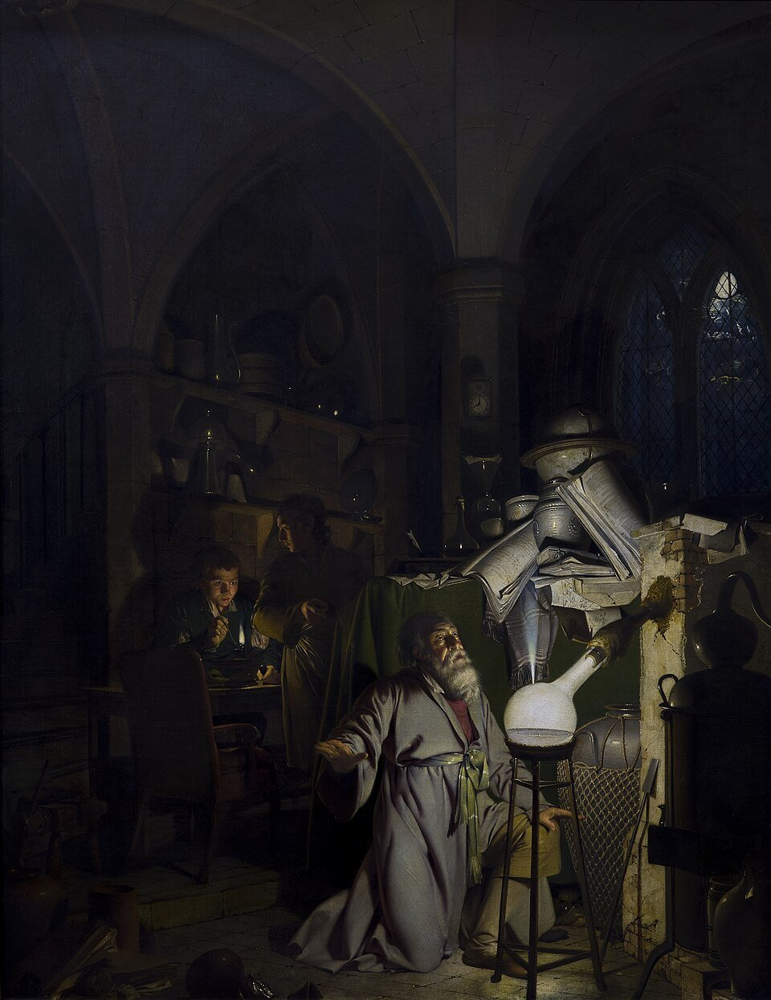

<p align="center">
  <picture>
    <source media="(prefers-color-scheme: dark)" srcset=".github/assets/wordmark-dark.svg">
    
  </picture>
</p>

<p align="center">
  
  <br>
  <sub><i>The Alchemist in Search of the Philosopher's Stone</i>, Joseph Wright of Derby, 1771. Public domain, via <a href="https://commons.wikimedia.org/wiki/File:Joseph_Wright_of_Derby_The_Alchemist.jpg">Wikimedia Commons</a>.</sub>
</p>

Phosphorus turns every computer you own into one shared desktop in the browser.
Install it on each machine (a **host**), and every host's terminals, files, web
services, chat and status show up together at your domain.

## Install

Download the installer for your system from the
[latest release](https://github.com/pmghartman/phosphorus/releases/latest):

| System | You need first | Then |
|---|---|---|
| Linux (Debian, Ubuntu) | nothing | `sudo apt install ./phosphorus_VERSION_amd64.deb` (or `arm64`) |
| macOS | [colima](https://github.com/abiosoft/colima) and Homebrew `docker`, `docker-compose` | open the `.dmg`, drag Phosphorus to Applications, right-click > Open |
| Windows | Docker Desktop, with host networking on | run the setup `.exe` (SmartScreen: More info > Run anyway) |

Then open the `.env` file in the host's folder, fill it in from `.env.example`
(your domain and Tailscale keys), and start it: `sudo phosphorus start` on Linux,
or Start in the tray icon on macOS and Windows.

The host's folder: `/var/lib/phosphorus` (Linux), `~/Library/Phosphorus` (macOS),
`%USERPROFILE%\phosphorus` (Windows). Updates never touch your settings or files there.
Tailscale keys expire every 90 days.

## Using it

Open your domain in a browser and log in with your phosphorus user. On first start
there are no users: log in as `admin` with `PHOSPHORUS_UPDATE_PASSWORD` from `.env`
and make an admin user (the setup admin turns off once one exists). Admins add and
delete users and give out admin from the users icon.

The first time a user logs in they log in to one or more hosts with that machine's
own user and password; those logins are saved to their profile for next time. A
host online but not logged in shows a lock in the bottom bar: click it to log in.
The profile button in the bar holds saved hosts, page logins, the password and log out.
Users live in each host's `state/sys/` (`etc/passwd`, `etc/shadow`, `home/<user>/vault`),
copied to every host, each user's vault sealed with their own password. You get a desktop:

- **terminal**: a shell on each host you logged in to
- **files**: every host's shared folders; copy and move between hosts, drag files in to upload
- **editor**: edit text files live with others, saved as you type (ctrl+s saves now)
- **chat**: channels and direct messages; `/chimp` asks the AI model
- **status**: CPU, memory, disk and network for every host, and which AI model is in use
- **projects**: hand a longer task to the big AI model and watch it work
- **git**: your own git server
- **games**: start and stop game servers, get the join address
- every other web service your hosts publish, with its own icon

Windows move, snap to edges and resize from any side. In the bar at the bottom:
your open windows, your hosts (purple is the one serving this page; click another
to switch), the mesh map, updates, and light or dark theme.

## Updating

Click the update icon in the bottom bar and press update: every host updates, one at
a time. Or run `phosphorus update` on a single host.

## Settings

Two files in `config/`, applied a few seconds after you save them.

`phosphorus.ini`, what this host does:

```
[files]
dir = files, /srv/media
priv = rwd, r

[git]
host = true

[model]
host = true
gpu = true
url = https://huggingface.co/ggml-org/gpt-oss-120b-GGUF/resolve/main/gpt-oss-120b-MXFP4.gguf
```

- `[files]`: the folders to share, and for each `r` read, `w` write, `d` delete.
- `[git]`: keep a copy of the git server on this host.
- `[model]`: run the AI model here (needs memory about the model file's size),
  on an nvidia `gpu` if set, from the `.gguf` at `url`.

Never share `/` or a home folder: shares have no login.

`services.export`, the web services and game servers on this host:

```
[grafana]
port = 3001

[terraria]
port = 7777
type = game
start = systemctl --user start tmodloader
stop = systemctl --user stop tmodloader
```

A service shows up at `yourdomain/host/name/`, or at `name.yourdomain` with
`mode = subdomain`. Game servers are reachable only inside the mesh.

## Command line

`phosphorus` (or `phos`) opens the same view in a terminal. `phosphorus start`,
`stop`, `restart` and `update` control this host.

## License

Copyright © 2026 Patrick Hartman. Apache License 2.0, see `LICENSE`.
Third-party licenses in `THIRD_PARTY_NOTICES.md`.
