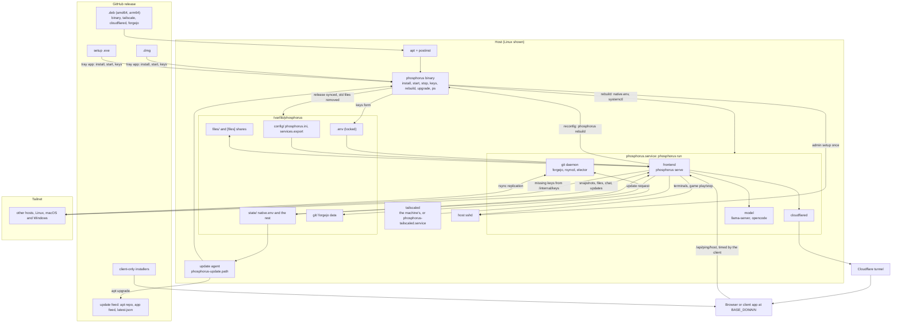

<p align="center">
  <picture>
    <source media="(prefers-color-scheme: dark)" srcset=".github/assets/wordmark-dark.svg">
    
  </picture>
</p>

<p align="center">
  
  <br>
  <sub><i>The Alchemist in Search of the Philosopher's Stone</i>, Joseph Wright of Derby, 1771. Public domain, via <a href="https://commons.wikimedia.org/wiki/File:Joseph_Wright_of_Derby_The_Alchemist.jpg">Wikimedia Commons</a>.</sub>
</p>

Every computer you own as one shared desktop in the browser: terminals, files, web services, chat, status, git and a local AI model across all hosts, at your domain.

## Install

From the [latest release](https://github.com/pmghartman/phosphorus/releases/latest), per OS:

| System | Client only | Host | Host needs |
|---|---|---|---|
| Linux | `sudo apt install ./phosphorus-client_VERSION_ARCH.deb` | `sudo apt install ./phosphorus_VERSION_ARCH.deb`, then `sudo phosphorus` | systemd |
| macOS | `phosphorus-client-VERSION-macos-universal.dmg` | `phosphorus-VERSION-macos-universal.dmg` | the Tailscale app, installed by first start if missing (allow its VPN configuration) |
| Windows | `phosphorus-client-VERSION-windows-x86_64-setup.exe` | `phosphorus-VERSION-windows-x86_64-setup.exe` | Tailscale for Windows, installed by first start if missing |

The client is the mesh's frontend in a window with no menu bar (on macOS no title bar either, the window buttons kept); it asks for the mesh's domain on first start. Closing the window leaves the app in the tray; Quit ends it. The macOS and Windows host apps bundle the client as an app of its own: opening Phosphorus (or Open in the tray) starts the client full size on the mesh's domain, in its own process with its own Dock or taskbar icon, while the tray utility keeps running the host in the background.

The host installer carries the `phosphorus` binary, which installs the release into the host folder (`/var/lib/phosphorus`, `~/Library/Phosphorus` or `%USERPROFILE%\phosphorus`) and brings it up. There are no scripts to run.

Nothing runs in containers. `phosphorus run` keeps the frontend, cloudflared, the model and (Linux) the git daemon as its own labelled child processes; `phos ps` shows them by role and the status tab sums them.

| | Service | Logs | Tailscale | Bundled |
|---|---|---|---|---|
| Linux | `phosphorus.service` (systemd) | `journalctl -u phosphorus` | the machine's `tailscaled` when running, else `phosphorus-tailscaled.service` | tailscale, cloudflared, forgejo in `/usr/libexec/phosphorus` |
| macOS | LaunchAgent `dev.phosphorus.host` | `~/Library/Phosphorus/state/phosphorus.log` | the Tailscale app | cloudflared in the host folder's `tools/` |
| Windows | the `phosphorus` service | `%USERPROFILE%\phosphorus\state\phosphorus.log` | Tailscale for Windows | cloudflared in the host folder's `tools\` |

On Linux the distro packages a role needs (git, rsync, sqlite3 on a git host, curl, ripgrep, libgomp1 on a model host) are installed on the first start that needs them. Git hosts are Linux only: forgejo ships for Linux alone. The Windows service is installed once through the admin prompt `phos start` raises; after that the signed-in account starts and stops it.

## Keys

On first start the app opens a keys window and `phosphorus` opens a keys form. Paste the keys there; they go into the host folder's `.env`.

| Key | Needed |
|---|---|
| `TS_AUTHKEY` | always, a reusable Tailscale auth key |
| `BASE_DOMAIN` | first host of a mesh, copied from a peer otherwise |
| `TUNNEL_TOKEN` | first host of a mesh, copied from a peer otherwise |
| `TS_API_KEY` | optional, game split DNS, copied from a peer otherwise |
| `ADMIN_PASS` | optional, setup admin login and mesh update gate, copied from a peer otherwise |

A host joining an existing mesh needs only `TS_AUTHKEY`: once on the tailnet it copies the rest from the first peer that answers.

`.env` is readable only by root on Linux, by the app's account on macOS, and by the app's account plus SYSTEM on Windows. Saved keys are never displayed; typed ones are. To replace one, use Edit Keys in the tray, `phos keys`, or `k` in the cli. Paste the new value; blank fields keep what is set. Saving restarts phosphorus with the new keys.

First login: user `admin`, password `ADMIN_PASS`; create a real admin and that login turns off.

Uninstall: Uninstall in the tray (or the app menu on macOS), or `phos uninstall`. It removes the service, the admin setup, PATH entries, the home with its git data and shares, the app's own folders and the app itself. On Linux it purges the package.

## Config

`config/phosphorus.ini`, applied on save:

```ini
[files]
dir = files, /srv/media   # shared folders
priv = rwd, r             # read, write, delete per folder

[home]
dir = files               # which share holds home/ (users, shared/, sys/)

[git]
host = true               # run a git server replica here

[model]
host = true               # run the AI model here (projects coming soon)
gpu = true
url = https://huggingface.co/.../model.gguf
```

`config/services.export`, web services and game servers on this host:

```ini
[grafana]
port = 3001               # yourdomain/host/grafana/, or mode = subdomain

[terraria]
port = 7777
type = game
start = systemctl --user start tmodloader
stop = systemctl --user stop tmodloader
```

## Use

- `phosphorus` (or `phos`): the cli; `start`, `stop`, `restart`, `update`, `update all`, `keys`, `ps` (Linux: phosphorus's processes by role)
- Host app (macOS, Windows): opening it starts the bundled client; tray: Open, Start, Stop, Check for Updates, Edit Keys, Uninstall, Quit (stops phosphorus too)
- Mesh update: update icon in the bar (admins) or `phos update all`. Every peer updates at once through its own installer, then the host that started it
- Projects: coming soon, shelved while their sandboxes are rebuilt; `/api/projects` still lists past ones

## How it fits together



## Layout

```
cmd/          phosphorus: roles (serve, model, elector, cli, ssh-relay), host commands (run, start, rebuild, ps and the rest); webbuild
internal/     Go packages, internal/host the host side the installers run
web/          browser client, bundled into the binary by go generate
gitd/         the git daemon a Linux git host runs: forgejo, rsync replication, the elector
config/       default host config
packaging/    tools.sh (bundled tools), deb/ (Linux host: units) and app/ (Tauri app: the client everywhere, the host tray on macOS and Windows)
```

`make build`, `make check`, `make test`.

## License

Apache 2.0, see `LICENSE` and `THIRD_PARTY_NOTICES.md`.
